<p align="center">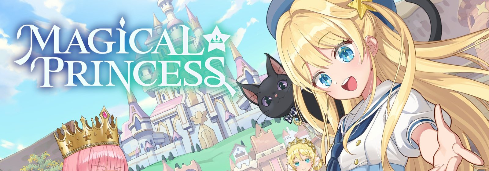</p>

<h1 align="center">Magical Princess · Native Android</h1>

<p align="center"><a href="README.md">简体中文</a> · <b>English</b></p>

<p align="center">
The Steam release of <i>Magical Princess</i>, recompiled as an arm64 Android app.<br>
No emulator and no Windows translation layer. The game data is downloaded with your own Steam account.
</p>

<p align="center">


</p>

---

## Why

*Magical Princess* is a daughter-raising sim: she starts school, picks classes, takes side jobs, makes friends, and three years later you see who she has become. It's the kind of game you want to play lying on the couch with a handheld, but it only ships for Windows and macOS.

The usual way to run a PC game on Android is a translation layer such as Winlator or GameHub. It works, but it costs battery, runs warm and loads slowly. This game is built with Unity, though, and the PC version uses Mono, so all of its managed assemblies are right there. That allows a different approach: take the game's own assemblies, compile them to an IL2CPP arm64 library with the exact same Unity version, and convert the assets and shaders into something Android can read. This repository holds every tool and change that pipeline needs.

Tested mainly on the AYN Thor (Snapdragon 8 Gen 2). The game uses a single screen, so ordinary Android phones and tablets work too.

## Screenshots

<table>
<tr>
<td width="50%">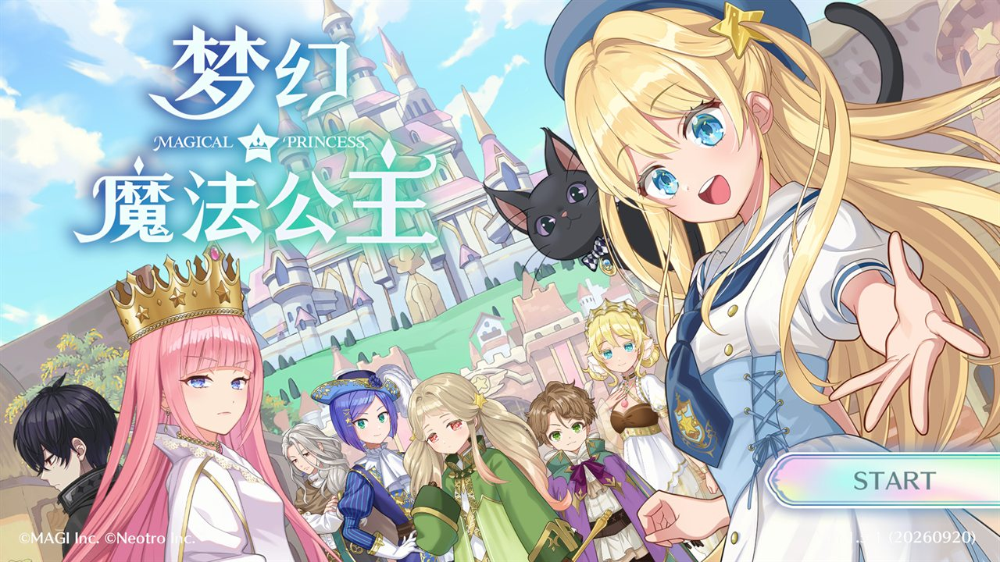</td>
<td width="50%">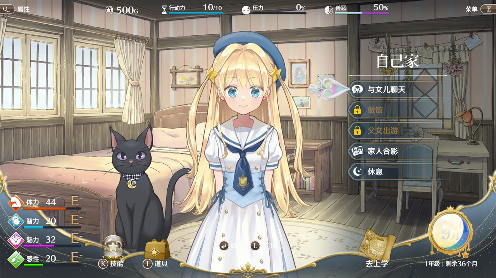</td>
</tr>
<tr>
<td align="center"><sub>Title screen, in the game's own Simplified Chinese</sub></td>
<td align="center"><sub>Each day starts at home: talk, cook, go out, rest</sub></td>
</tr>
<tr>
<td>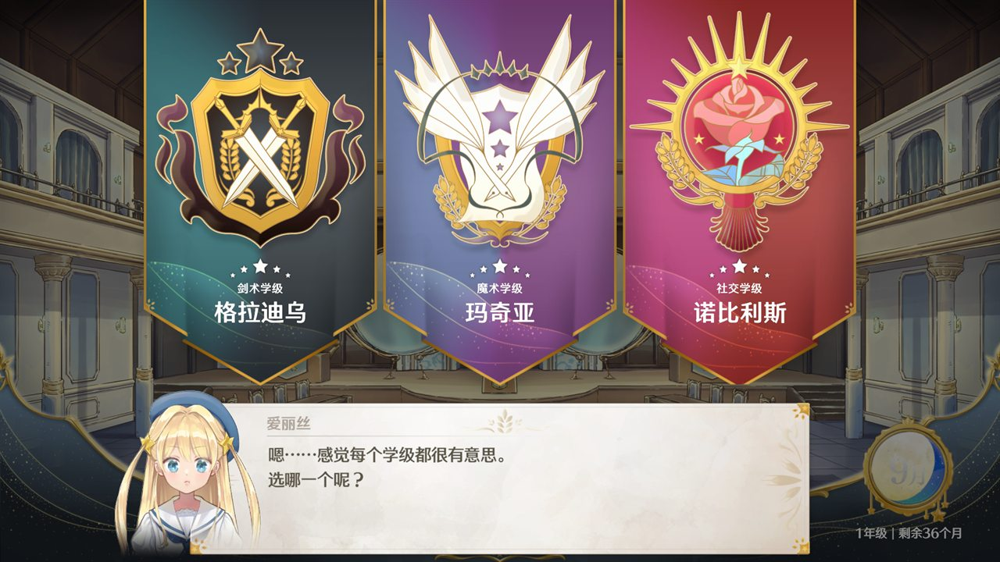</td>
<td>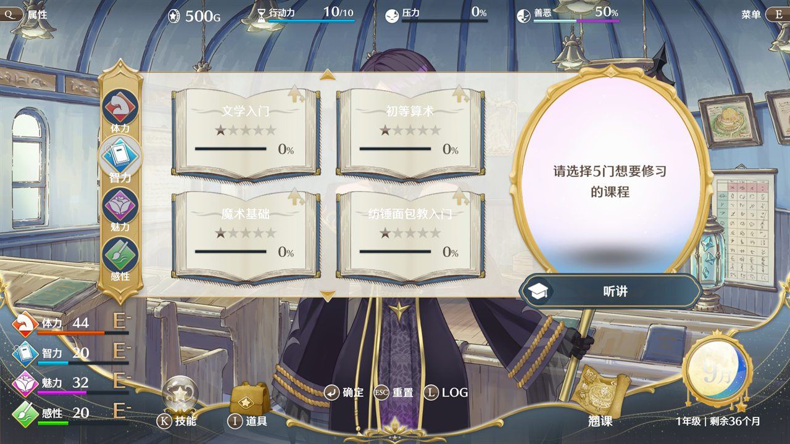</td>
</tr>
<tr>
<td align="center"><sub>Picking a class at the entrance ceremony</sub></td>
<td align="center"><sub>Planning lessons at the start of each month</sub></td>
</tr>
<tr>
<td></td>
<td>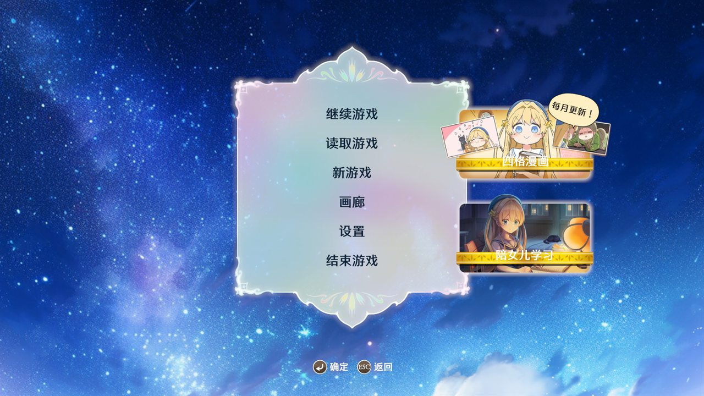</td>
</tr>
<tr>
<td align="center"><sub>The academy square: a 3D scene with 2D characters</sub></td>
<td align="center"><sub>Saves use the same format as the PC version</sub></td>
</tr>
</table>

<sub>In-game shots were taken on an Android emulator running the same arm64 build that runs on the Thor.</sub>

## Launcher

The app opens on a small launcher that takes care of Steam sign-in, the game data download and settings. Once the data is in place, "Start" goes straight into Unity.

<table>
<tr>
<td width="50%">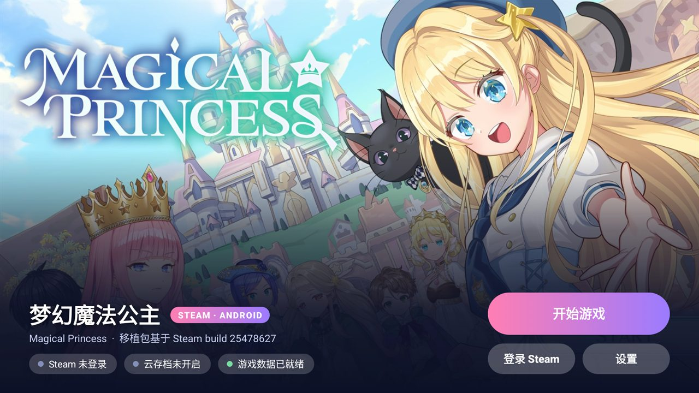</td>
<td width="50%">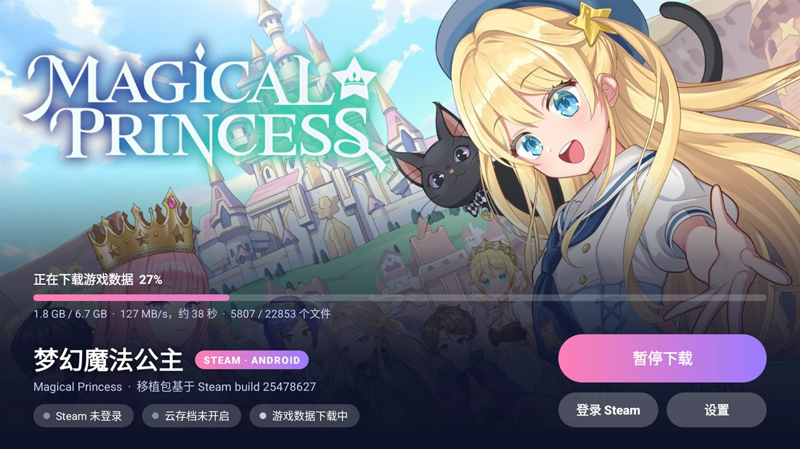</td>
</tr>
<tr>
<td align="center"><sub>Three status chips at the bottom: Steam, cloud saves, game data</sub></td>
<td align="center"><sub>First launch downloads 6.7 GB from Steam; pause and resume both work</sub></td>
</tr>
<tr>
<td>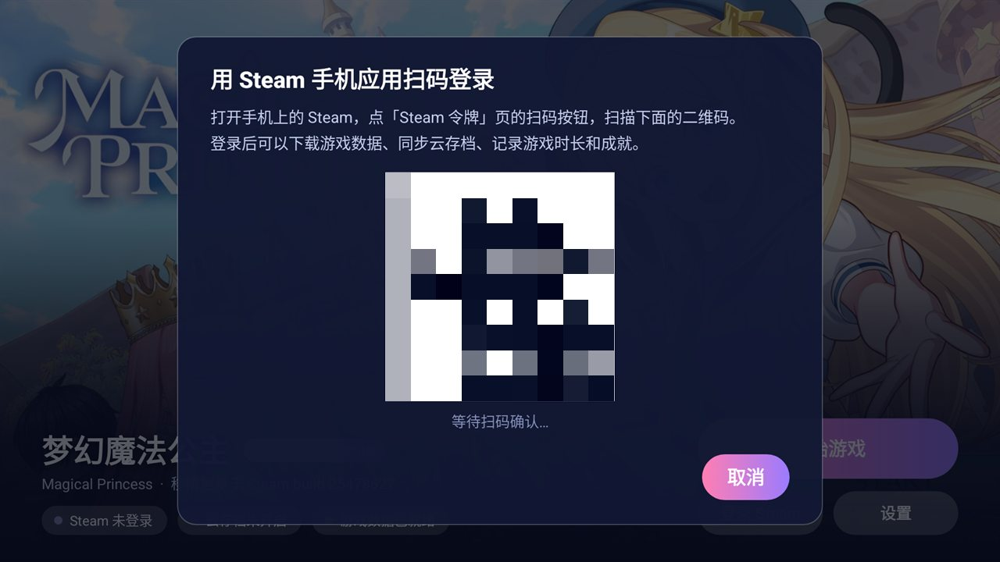</td>
<td>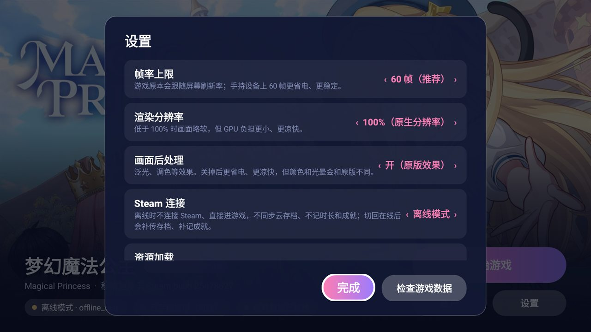</td>
</tr>
<tr>
<td align="center"><sub>Sign in by scanning with the Steam mobile app, no password typed (code blurred)</sub></td>
<td align="center"><sub>Frame rate, render scale, post-processing, offline mode</sub></td>
</tr>
</table>

<p align="center">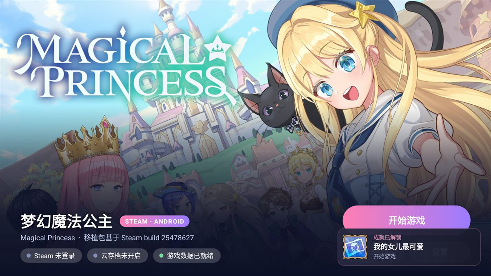<br>
<sub>When an achievement reaches Steam, a card slides in at the bottom right with the icon and name from Steam</sub></p>

## Features

**The game**

- The whole game: story, lessons, outings, conversations, battles, gallery. Saves use the PC format
- Frame rate cap (60 by default). The PC version follows the monitor's refresh rate, which only wastes battery on a handheld
- Lower render scale for less heat and longer battery life
- Post-processing (bloom, color grading) can be turned off to save power, at the cost of slightly different colors
- Controllers work out of the box, including the Thor's built-in one

**Touch**

The game can already be played with a mouse alone, so single taps always worked. A few things a finger can't do were added:

- A quick two-finger tap means "back"
- Long gallery images scroll with a one-finger drag
- When choosing an area in battle, drag to aim and lift your finger to confirm
- Fixed "tapping the same spot twice does nothing" (the game only counted the mouse as active after it moved)

**Steam**

- QR sign-in; the session is kept on the device so you don't scan again
- First launch downloads the Windows data and converts it to Android bundles on the device. After a game update only the changed parts are downloaded
- Cloud saves shared with Steam on your PC
- "Playing Magical Princess" shows up for friends, and playtime is recorded
- Achievements sync to Steam, with an on-screen card when one unlocks
- Offline mode: skip Steam and go straight into the game; switching back online uploads saves and records achievements you earned meanwhile

## How it works

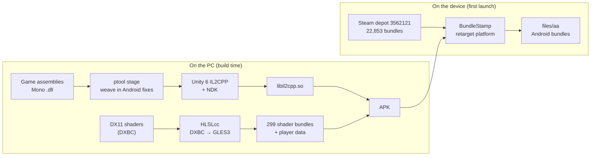

The main points:

- **Code**: the exact Unity version the game was built with (6000.3.20f1) supplies its IL2CPP toolchain and Android player. The game assemblies are compiled to `libil2cpp.so` from the command line; the editor is never opened. A handful of PC-only spots are patched before compiling: the Rewired input library hard-codes the Windows platform, a failed Steam init quits the game, and so on.
- **Shaders**: the PC version only carries DX11 bytecode. It is decompiled to GLSL ES 3.0 and written back in Unity 6's shader layout (sub-programs, parameter blobs, keyword masks). Several places where D3D and GL conventions differ needed individual fixes: comparison bit masks, the UV flip in full-screen triangles, and URP's per-light arrays sized for 256 lights, which exceed a mobile GPU's uniform limit and made whole 3D scenes vanish.
- **Assets**: of the 22,853 asset bundles, the ones without shaders differ from Windows by a single field, the target platform in the serialized file header. That happens on the device: only the first 128 KB LZ4 block is decompressed and rewritten, the rest is copied as is. The whole set converts in about 12 seconds on a PC and runs alongside the download on the phone. The 299 bundles that carry shaders (189 MB) are converted on the PC and shipped inside the APK.
- **Load times**: Addressables' async loading advances one step per frame. At 144 fps on a PC monitor nobody notices; capped at 60 fps, startup took close to two minutes. Requests now complete synchronously right after they're issued, which brings startup down to a little over twenty seconds. A "compatible" option in settings restores the original behavior.
- **Steam**: everything lives in the Java layer on top of JavaSteam: sign-in, depot downloads, cloud saves, achievements and presence never touch the game code. JavaSteam's zstd and xz dependencies are replaced with pure-Java versions. The game's own Steamworks calls are redirected to the Java layer.

<table>
<tr>
<td width="50%">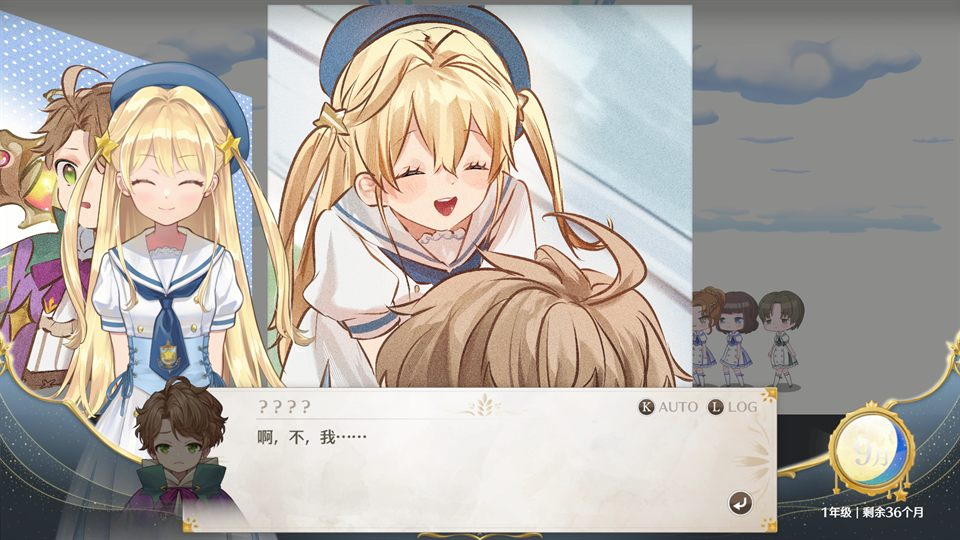</td>
<td width="50%">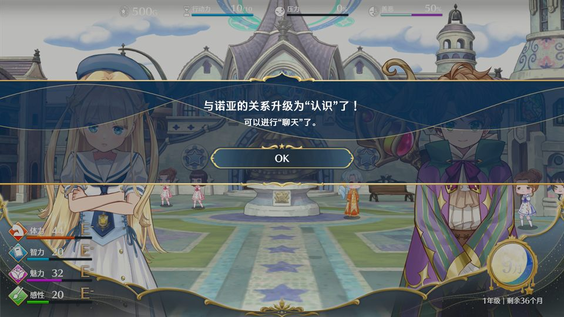</td>
</tr>
<tr>
<td align="center"><sub>Before: the URP/Lit shader failed to link, so buildings and ground were missing</sub></td>
<td align="center"><sub>After: light arrays cut to the 32 that Android URP uses</sub></td>
</tr>
</table>

## Repository layout

```
art/        launcher background, app icon (taken from the game's own icon)
cloud/      Java layer: launcher, Steam sign-in / download / cloud saves / achievements, settings, bundle conversion
docs/       images for this page
shots/      screenshots taken while verifying changes
tools/
  ptool/            asset and shader processing (C#, AssetsTools.NET): stage, rt-data, rt-bundles, shdump, matfind
  princessandroid/  Android-side code inside the game: controller, touch, frame rate, diagnostics
  pctest/           PC-side checks for the download path, manifests and icon generation
  build-*.sh        build scripts; rebuild.sh goes from source to APK in one command
  local.env.example template for the machine-specific paths (copy to tools/local.env)
HANDOFF.md  development log in Chinese: what was done, how it was verified, what went wrong
```

## Building it yourself

Everything runs on Windows. You need:

- A legitimate copy of *Magical Princess* on Steam, for the assemblies and reference data
- Unity 6000.3.20f1 with its Android module (only IL2CPP and the Android player are used)
- Android NDK, Android SDK build-tools, JDK 17 (the cloud module builds with Gradle)
- .NET 8 SDK (for ptool)
- An HLSLcc command-line build (for shader conversion)
- Git Bash

Copy `tools/local.env.example` to `tools/local.env` and fill in your SDK, NDK and adb paths. Then, roughly:

```bash
# 1. Convert the player data and the bundles that carry shaders (slow the first time)
ptool rt-data    <game>/MagicalPrincess_Data  <out>/data  <temp>  hlslcc-cli.exe  tools/ptool/classdata.tpk
ptool rt-bundles <game>/.../StandaloneWindows64  <out>/aa  <temp>  hlslcc-cli.exe  tools/ptool/classdata.tpk 8

# 2. Record the Steam build this port targets and collect the shader bundles
bash tools/make-port.sh

# 3. Weave in the Android code, compile IL2CPP, package the APK
bash tools/rebuild.sh
```

The result is an APK of about 590 MB that contains the shader bundles and no other game data. On first launch it walks you through Steam sign-in and the download. Parameters, paths and what each script does are covered in [HANDOFF.md](HANDOFF.md) (Chinese).

## Status

Playable: new game, story, entrance ceremony, lessons, outings and save/load all work. It has been played for a while on the Thor, with Steam sign-in and presence working. Achievement toasts and cloud saves were tested on the emulator and are still being checked on the device.

Open issues and things not yet verified:

- **Some material effects don't apply.** At night the central plaza's sky is white instead of dark blue, the fireflies don't show, and the backgrounds of comic panels don't go gray and dim. The cause is that shader variants are picked without the material's keywords; a fix is in progress and tracked in HANDOFF.md
- URP/Lit variants with additional-light shadows may still exceed the uniform limit on Adreno
- A complete download from scratch with a real Steam account: the download path was verified on a PC, but the Thor's data was pushed by hand, so the full first-run download hasn't been done end to end
- Gallery dragging and battle area selection by touch haven't been tried on a real device yet
- Only arm64 is built; no 32-bit or x86 version

## Notes

- This repository **does not distribute any game files** and no prebuilt APK is provided. The game data comes from your own Steam account; without a purchase the app can't do anything.
- The images in `art/` and `docs/` come from the game and are used only to describe this project.
- *Magical Princess* and its artwork are © MAGI Inc. and Neotro Inc.
- This is a personal research project with no connection to the developer or publisher.
