<p align="center">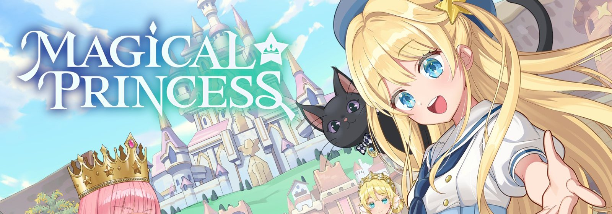</p>

<h1 align="center">梦幻魔法公主 · 安卓原生版</h1>

<p align="center"><b>简体中文</b> · <a href="README.en.md">English</a></p>

<p align="center">
把 Steam 上的《Magical Princess》重新编译成 arm64 安卓应用。<br>
不经过模拟器，也不跑 Windows 转译层。游戏数据用你自己的 Steam 账号下载。
</p>

<p align="center">


</p>

---

## 为什么做这个

Magical Princess 是一款养女儿的模拟养成游戏：入学、选课、打工、交朋友，三年后看她长成什么样的人。这类游戏很适合躺着拿掌机慢慢玩，可惜只有 Windows 和 Mac 版。

在安卓上跑 PC 游戏，常见做法是 Winlator、GameHub 之类的转译方案。能玩，但更费电、更烫，加载也慢。好在这款游戏是 Unity 做的，PC 版用的是 Mono，托管程序集都在。于是可以换个思路：拿游戏自己的程序集，用同一版本的 Unity 编成 IL2CPP arm64 原生库，再把资源和着色器转成安卓能读的格式。这个仓库就是这套流程用到的全部工具和改动。

主要在 AYN Thor（骁龙 8 Gen 2）上测试。游戏只用一块屏，普通安卓手机和平板也能装。

## 截图

<table>
<tr>
<td width="50%">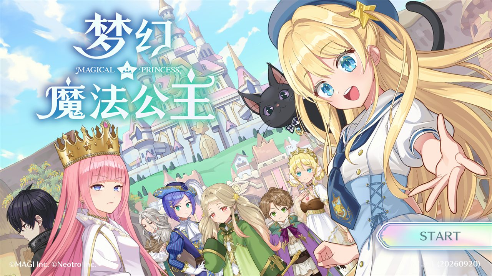</td>
<td width="50%">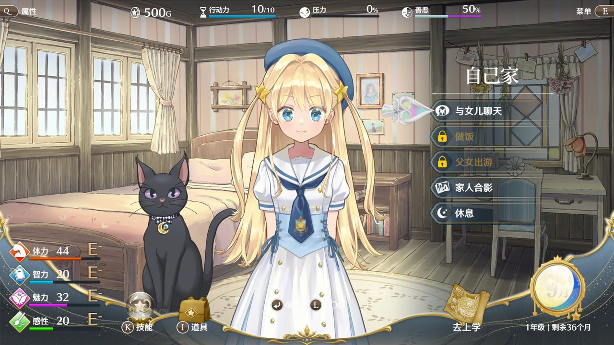</td>
</tr>
<tr>
<td align="center"><sub>标题画面，游戏自带的简体中文</sub></td>
<td align="center"><sub>每天从自己家出发：聊天、做饭、出游、休息</sub></td>
</tr>
<tr>
<td>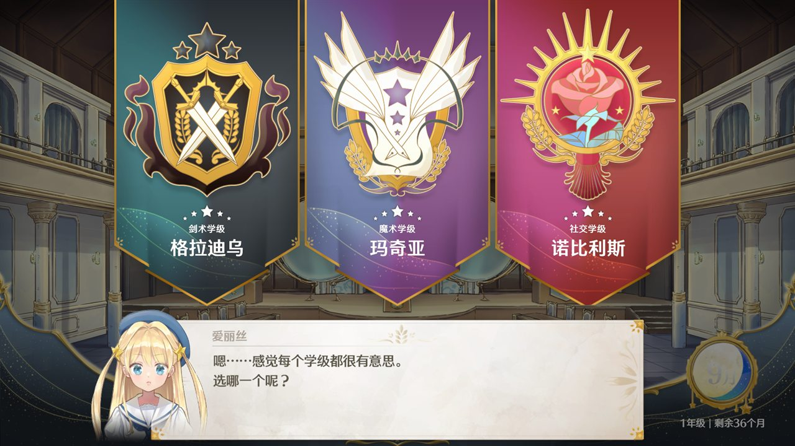</td>
<td>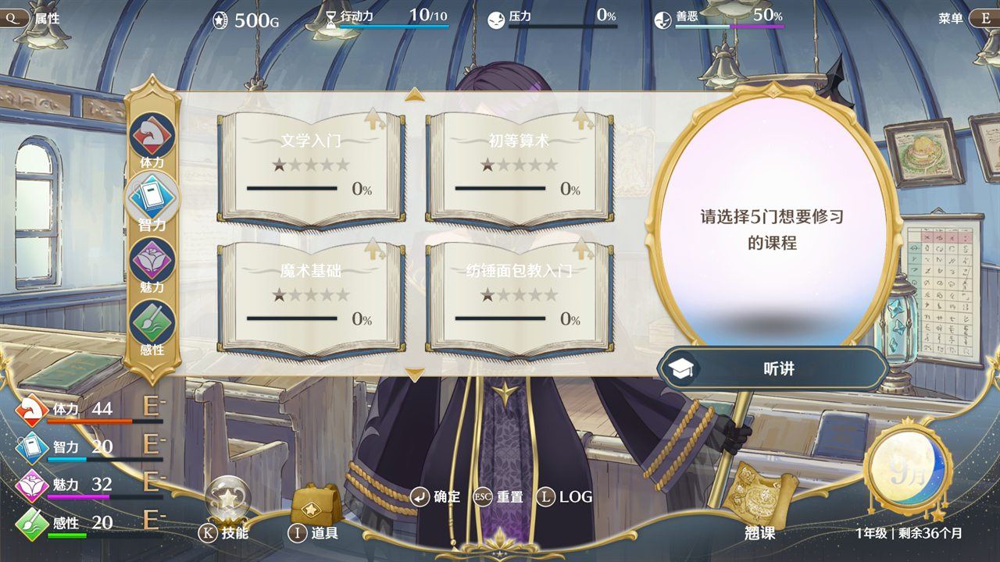</td>
</tr>
<tr>
<td align="center"><sub>入学典礼上选学级</sub></td>
<td align="center"><sub>每月月初排课</sub></td>
</tr>
<tr>
<td></td>
<td>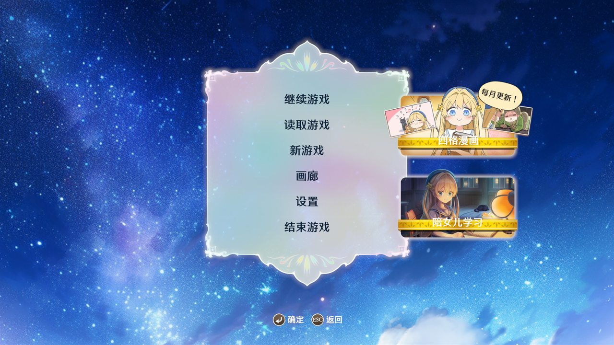</td>
</tr>
<tr>
<td align="center"><sub>学园广场，3D 场景加 2D 立绘</sub></td>
<td align="center"><sub>存档和 PC 版格式相同</sub></td>
</tr>
</table>

<sub>游戏画面截自 Android 模拟器，和 Thor 上跑的是同一个 arm64 包。</sub>

## 启动页

打开应用后先进入一个启动页，处理 Steam 登录、下载游戏数据和设置这几件事。数据就绪以后，点「开始游戏」就直接进 Unity。

<table>
<tr>
<td width="50%">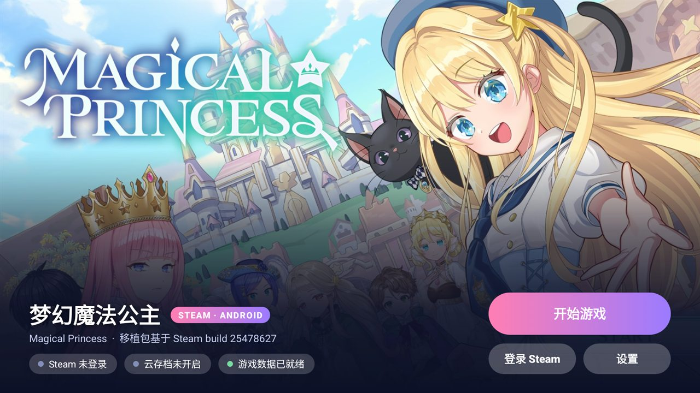</td>
<td width="50%">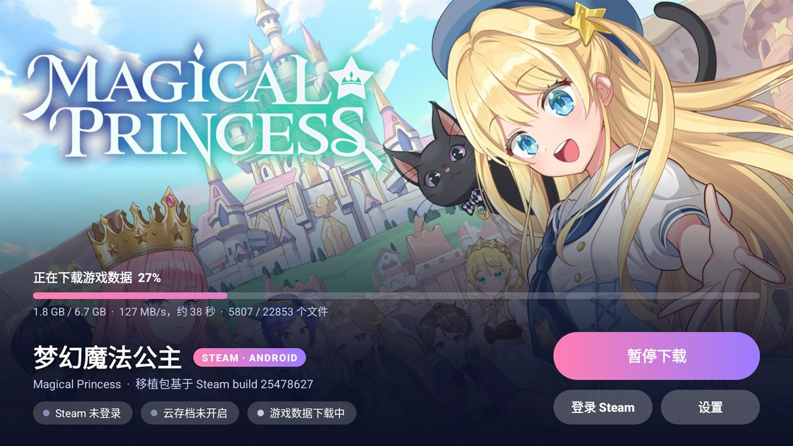</td>
</tr>
<tr>
<td align="center"><sub>底部三个状态：Steam、云存档、游戏数据</sub></td>
<td align="center"><sub>第一次打开时从 Steam 下载 6.7 GB 数据，可以暂停和续传</sub></td>
</tr>
<tr>
<td>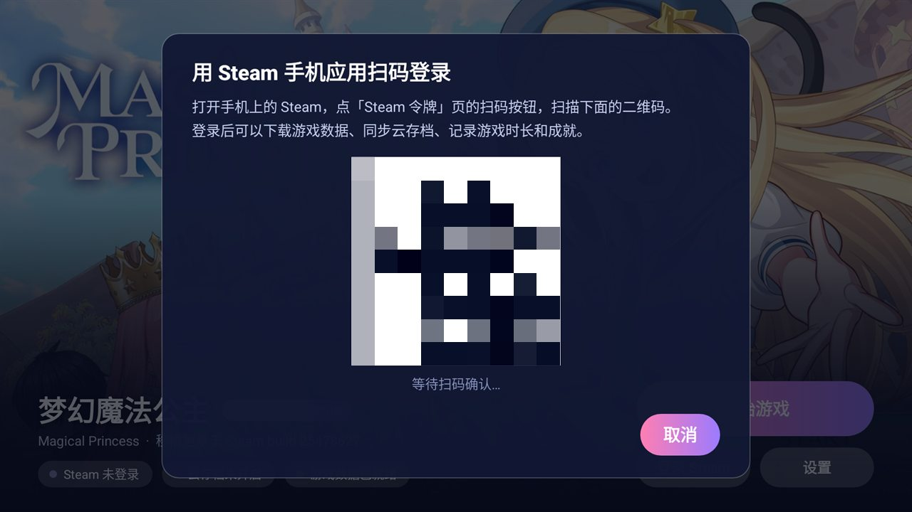</td>
<td>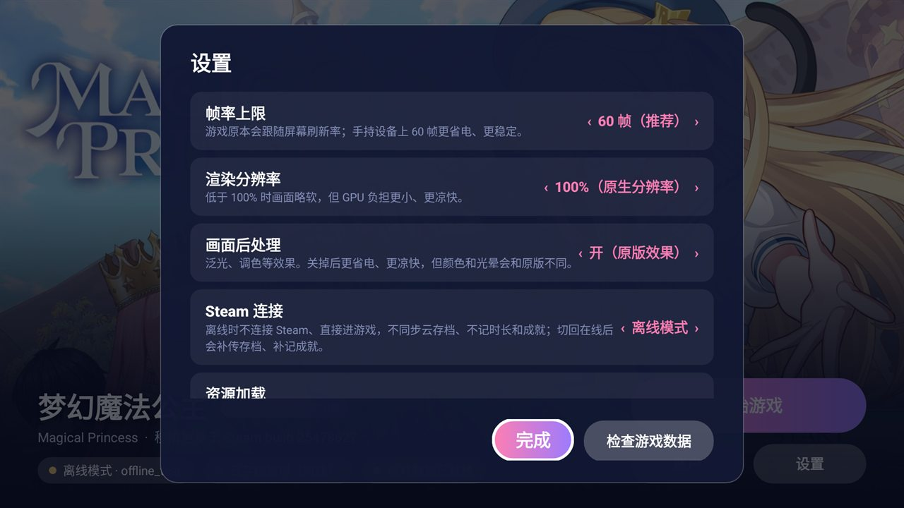</td>
</tr>
<tr>
<td align="center"><sub>用 Steam 手机应用扫码登录，不用输密码（二维码已打码）</sub></td>
<td align="center"><sub>帧率、渲染分辨率、后处理、离线模式</sub></td>
</tr>
</table>

<p align="center">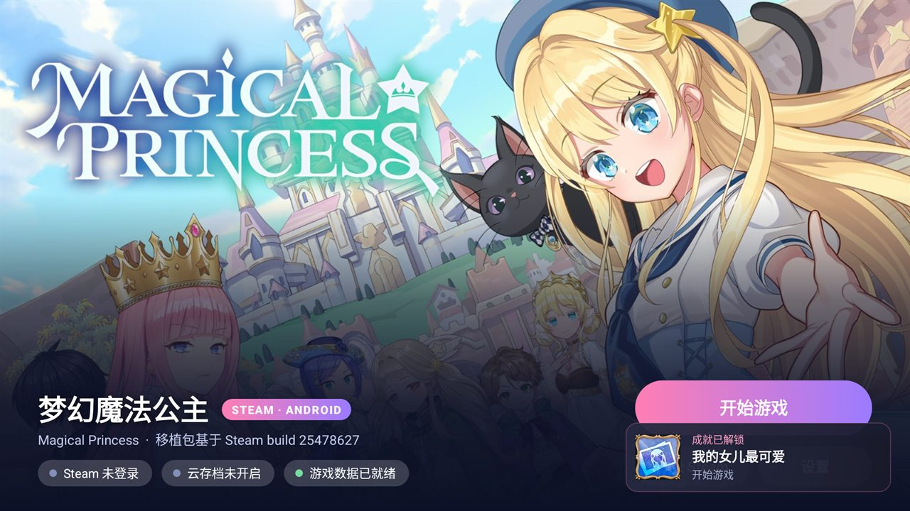<br>
<sub>成就同步到 Steam 后，右下角会弹出一张提示卡片，图标和名称取自 Steam</sub></p>

## 能做什么

**游戏本体**

- 完整的游戏流程：剧情、选课、外出、对话、战斗、画廊，存档和 PC 版格式相同
- 帧率上限可以设（默认 60）；PC 版会跟随显示器刷新率，在掌机上反而更费电
- 渲染分辨率可以调低，换取更低的温度和更长的续航
- 画面后处理（泛光、调色）可以关，关掉以后更省电，颜色会和原版有些差别
- 手柄直接可用，Thor 自带的手柄也行

**触屏**

游戏本来就能只用鼠标玩，所以单指点按一直能用。另外补上了几件手指做不到的事：

- 双指轻点一下等于「返回」
- 画廊里的长图可以单指上下拖动
- 战斗里选范围时，手指按住拖着瞄准，松手才确定
- 修了「点同一个位置第二次没反应」的问题（游戏要求鼠标动过才算在用鼠标）

**Steam**

- 扫码登录；登录信息存在本机，下次打开不用再扫
- 第一次打开时下载 Windows 版数据，在手机上转换成安卓用的资源包；Steam 上游戏更新后，只下载变化的部分
- 云存档和电脑上的 Steam 互通
- 好友列表里显示「正在玩」，游戏时长照常累计
- 成就同步到 Steam，解锁时弹出提示
- 可以切到离线模式：不连 Steam，直接进游戏；切回在线后补传存档、补记成就

## 怎么做到的

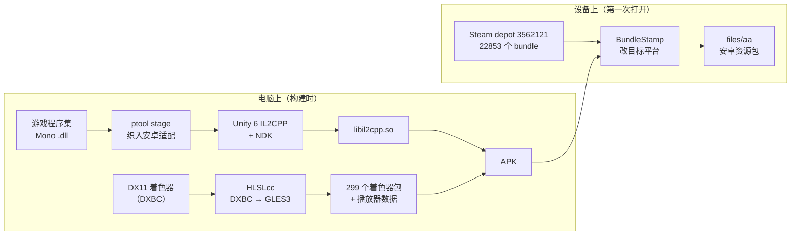

几个关键点：

- **代码**：用和游戏完全相同的 Unity 6000.3.20f1，只取它的 IL2CPP 工具链和安卓播放器，在命令行里把游戏程序集编成 `libil2cpp.so`，不用打开编辑器。少数几处 PC 专用逻辑在编译前就改掉：Rewired 手柄库写死了 Windows 平台，Steam 初始化失败时会直接退出游戏，诸如此类。
- **着色器**：PC 版只带 DX11 字节码。先把它反编译成 GLSL ES 3.0，再按 Unity 6 的着色器格式（子程序、参数块、关键字掩码）写回去。还有几处 D3D 和 GL 约定不同的地方要逐个修：比较结果的位掩码、全屏三角形的 UV 翻转、URP 按 256 个光源开的数组（超出手机 GPU 的 uniform 上限，会导致整片 3D 场景不显示）。
- **资源**：22853 个资源包里，没有着色器的那些和 Windows 版只差一个字段，也就是序列化文件头里的目标平台号。这一步在手机上做：只解压、改写第一个 128 KB 的 LZ4 块，其余部分原样拷贝。整套数据在电脑上转一遍大约 12 秒，手机上和下载同时进行。带着色器的 299 个包（189 MB）在电脑上转好，直接放进 APK。
- **加载速度**：Addressables 的异步加载每帧只推进一步。PC 上显示器 144 帧，看不出问题；锁到 60 帧以后，启动要将近两分钟。现在请求一发出就同步取结果，启动降到二十几秒。设置里留了「兼容」选项，可以换回原来的方式。
- **Steam**：全部放在 Java 层，用 JavaSteam 实现，登录、depot 下载、云存档、成就、在线状态都不经过游戏代码。JavaSteam 依赖的 zstd 和 xz 换成了纯 Java 实现。游戏里原有的 Steamworks 调用改成转给 Java 层处理。

<table>
<tr>
<td width="50%">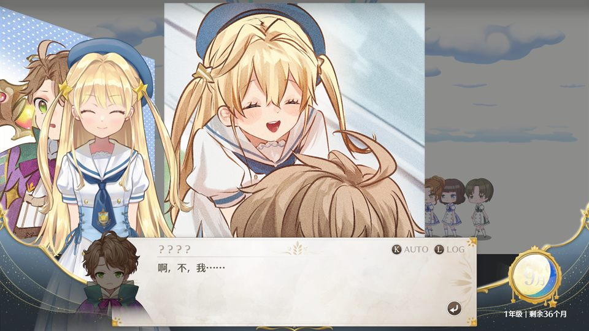</td>
<td width="50%">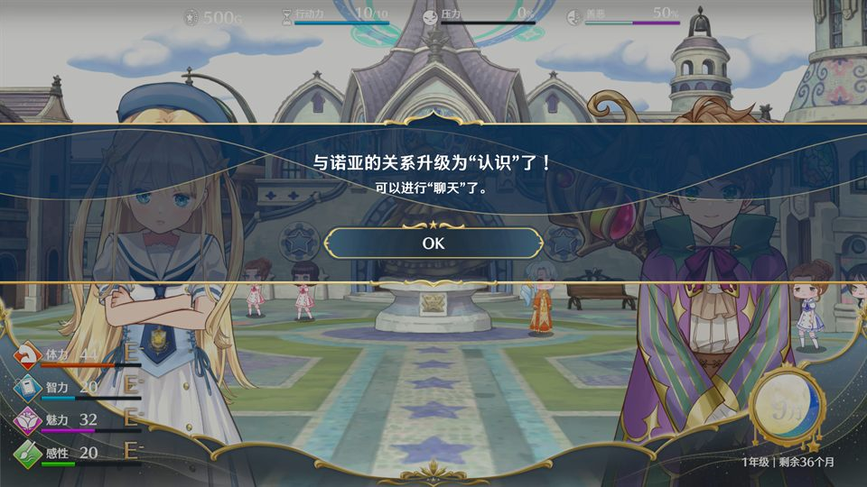</td>
</tr>
<tr>
<td align="center"><sub>修复前：URP/Lit 着色器链接失败，建筑和地面整片缺失</sub></td>
<td align="center"><sub>修复后：光源数组改成安卓版 URP 的 32 个</sub></td>
</tr>
</table>

## 仓库结构

```
art/        启动页背景、应用图标（取自游戏自带的图标）
cloud/      Java 层：启动页、Steam 登录 / 下载 / 云存档 / 成就、设置、资源包转换
docs/       这份说明用的图片
shots/      开发过程中的验证截图
tools/
  ptool/            资源和着色器处理（C#，AssetsTools.NET）：stage、rt-data、rt-bundles、shdump、matfind
  princessandroid/  游戏里的安卓适配代码：手柄、触屏、帧率、诊断
  pctest/           在电脑上验证下载链路、清单和图标生成
  build-*.sh        构建脚本；rebuild.sh 一条命令从源码到 APK
  local.env.example 本机路径模板（复制成 tools/local.env 再填）
HANDOFF.md  开发记录：每一步做了什么、怎么验证的、踩过哪些坑
```

## 自己构建

都在 Windows 上完成，需要准备：

- 正版 Magical Princess（Steam），用来取程序集和对照数据
- Unity 6000.3.20f1 和它的 Android 模块（只用里面的 IL2CPP 和安卓播放器）
- Android NDK、Android SDK build-tools、JDK 17（cloud 用 Gradle 构建）
- .NET 8 SDK（构建 ptool）
- 一份 HLSLcc 命令行工具（着色器转换用）
- Git Bash

先把 `tools/local.env.example` 复制成 `tools/local.env`，填上自己的 SDK、NDK 和 adb 路径。然后大致是：

```bash
# 1. 转换播放器数据和带着色器的资源包（第一次要几十分钟）
ptool rt-data    <游戏>/MagicalPrincess_Data  <输出>/data  <临时目录>  hlslcc-cli.exe  tools/ptool/classdata.tpk
ptool rt-bundles <游戏>/.../StandaloneWindows64  <输出>/aa  <临时目录>  hlslcc-cli.exe  tools/ptool/classdata.tpk 8

# 2. 记录这次构建对应的 Steam 版本，收集着色器包
bash tools/make-port.sh

# 3. 织入适配代码、编译 IL2CPP、打包 APK
bash tools/rebuild.sh
```

产物是一个约 590 MB 的 APK，里面包含着色器包，不含其他游戏数据。装到设备上以后，第一次打开会引导你登录 Steam 下载数据。每个脚本的参数、路径和做法都写在 [HANDOFF.md](HANDOFF.md) 里。

## 现状

能正常游玩：开新档、走剧情、入学选课、外出、读写存档都跑通过。Thor 上已经实际玩过一段，Steam 登录和「正在玩」状态正常。成就提示和云存档在模拟器上测过，真机还在测。

还有这些问题没解决或没验证：

- **一部分材质效果不生效。** 夜晚的中央广场天空发白，应该是深蓝夜空；萤火虫特效不显示；过场漫画格的背景不会变灰变暗。已经查到原因是游戏选着色器变体时没有用上材质的关键字，正在修，进展记在 HANDOFF.md
- 带附加光阴影的 URP/Lit 变体，在 Adreno 上可能仍然超出 uniform 上限
- 用真实 Steam 账号从零下载完整数据：下载链路在电脑上验证过，Thor 上的数据是先推进去的，从零下载还没完整走一遍
- 画廊长图拖动、战斗选区这两项触屏改动，还没在真机上用过
- 只编了 arm64，没有 32 位和 x86 版本

## 说明

- 这个仓库**不发布任何游戏文件**，也不提供构建好的 APK。游戏数据从你自己的 Steam 账号下载，没有购买游戏的话应用没法用。
- `art/` 和 `docs/` 里的图片来自游戏本身，仅用于说明这个项目。
- Magical Princess 及其美术素材的版权属于 MAGI Inc. 和 Neotro Inc.。
- 这是个人研究项目，和开发商、发行商都没有关系。
